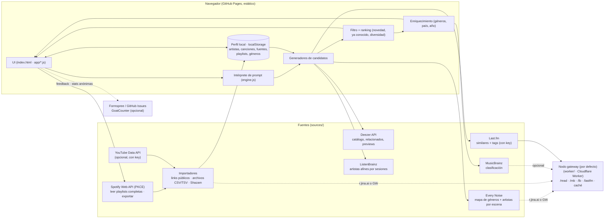

# Órbita — arquitectura



## Módulos del cliente
`sources/*.js`, `engine.js`, `prompts.js`, `feedback.js` y `map.js` siguen siendo scripts clásicos (globales, sin build). La app vive en módulos ES bajo `app/`, cargados con `<script type="module" src="app/main.js">`:

| módulo | contenido |
|---|---|
| `app/util.js` | helpers sin estado: `$`, `esc`, `K`/`TK`, `safeHref`, `toast`, `links`… |
| `app/session.js` | perfil persistente (`db`, `persist`, `addArtist`, `applyProfile`) y **`S`**, el único objeto con estado mutable de la sesión: `knownTracks`, `knownIds`, `session` (búsqueda actual), `now`/`queue`/`qi` (reproductor), `dStack` (detalle), `curPl`, `mapT` |
| `app/ranking.js` | candidatos por fuente (`fromArtists`, `fromScenes`, `fromTaste`, `fromDeep`, `fromEveryNoise`, `fromLibs`), `rank`, `gather`, `refill`, `nextItems` |
| `app/player.js` | previews, cola y acciones del reproductor |
| `app/ui.js` | vistas, tarjetas, detalle, playlists, importaciones y arranque |
| `app/main.js` | entrada; expone en `window` lo que usan `map.js` y `sync.js` |

`session.js` no importa `ui.js`: la UI registra sus callbacks en `hooks` para evitar el ciclo. Tests: `npm test` (Vitest; `test/load.js` carga los scripts clásicos en un `node:vm`).

## Flujo de una búsqueda
1. **Intención** (`parseIntent`): mood/actividad, géneros (diccionario + ~6,300 géneros de Every Noise), artistas semilla (`como X`), canciones nuevas de un artista (`más de X`, `de mis artistas`), `desde mis shazams`, formato, época y región.
2. **Escenas** (`pickScenes`): géneros del prompt, géneros de tu perfil cuando no escribes nada y, si subes “qué tan nuevo”, géneros vecinos según Every Noise.
3. **Candidatos**, en paralelo:
   - Deezer: playlists por escena y artistas relacionados, a 1 y 2 pasos.
   - Every Noise: artistas de la escena, más profundos en la lista cuanto más nuevo pidas.
   - ListenBrainz y Last.fm: artistas afines a tus semillas.
   - Perfil: tus artistas o tus Shazams.
   - Deep cuts: canciones de álbumes de un artista que no tienes registradas.
4. **Filtro y ranking** (`rank`): descarta lo que ya conoces (artistas, canciones e IDs), puntúa por popularidad según la novedad pedida y penaliza las escenas repetidas.
5. **Cola** (`nextItems`): entrega 9 resultados (25 en formato playlist) y rellena para que cada ♡ / ✓ / ↻ reemplace la tarjeta en su lugar.
6. **Enriquecimiento** (`enrichTiles`): MusicBrainz agrega a cada artista géneros, país y año, con un límite de 1 petición por segundo y caché de 30 días.
7. **Salida**: playlists locales, exportar a Spotify o copiar a TuneMyMusic / Soundiiz.

## Importar playlists grandes
Las páginas públicas (embed de Spotify, playlist de YouTube, Apple Music) solo muestran ~100 canciones; el importador lo detecta (`truncated`) y avisa. Para leer completas:
- **Spotify Web API** (`Spotify.readPlaylist`, `Spotify.myPlaylists`): pagina `/me/playlists` y `/playlists/{id}/items` de 50 en 50. Requiere los scopes `playlist-read-*`; si el token no los tiene, el link público sigue como respaldo.
- **Archivo** (`parseFileTracks`): CSV de Exportify / TuneMyMusic / Soundiiz o TSV UTF‑16 de Apple Music. Detecta columnas de título y artista por nombre.
- **YouTube Data API** (`importYouTubeApi`): si `config.js → youtubeKey` existe, pagina `playlistItems`.

## Perfil público de Spotify (sin login)
`readSpotifyProfile` lee con el mismo lector público `open.spotify.com/user/{id}`, `/playlists` y `/recently-played-artists`: nombre, playlists públicas y, si el usuario los muestra, ~25 artistas recientes (se registran con peso 3). Cada playlist se importa con `importSpotify`, así que sin OAuth sigue el tope de ~100 canciones. No es público: a quién sigue, top artistas, canciones guardadas, playlists privadas ni historial. No se usan las APIs internas del reproductor web.

## PWA y seguridad
- `sw.js` precachea el shell (HTML, CSS, JS, `vendor/d3.min.js`, ícono, manifest): la app abre sin conexión y muestra gustos, guardados y playlists desde `localStorage`. Archivos propios: red primero y caché si no hay red; Google Fonts: caché primero; las APIs externas no se interceptan. Sube `VERSION` en `sw.js` si cambia la lista de archivos.
- D3 está vendorizado en `vendor/d3.min.js` (v7.9.0), sin CDN.
- `index.html` declara una CSP: scripts solo propios + JSONP de Deezer + GoatCounter, sin `unsafe-inline` en scripts (los estilos inline sí, por los `style=` de portadas). `connect-src` lista cada API; **si `apiBase` no es un `*.workers.dev`, agrega su dominio a `connect-src`**. `referrer` = `strict-origin-when-cross-origin` (la key de YouTube restringida por dominio necesita el origen).
- Todo texto externo (Deezer, MusicBrainz, Every Noise, Spotify, playlists importadas, respaldos restaurados, campos `why`) pasa por `esc()` antes de `innerHTML`; URLs por `safeHref`/`cssUrl`.

## Feedback y medición
`feedback.js` agrega el formulario de feedback (POST JSON a `config.js → feedbackUrl`, p. ej. Formspree; sin él abre un issue de GitHub prellenado), la nota de privacidad y estadísticas anónimas con GoatCounter (`config.js → goatcounter`): vistas por sección y eventos `buscar`, `importar-*`, `exportar-spotify`, `feedback`, `error`. Sin cookies.

## Nodo gateway (camino por defecto)
Cuando `config.js → apiBase` tiene la URL del Worker, **todas** las llamadas a Every Noise, `r.jina.ai` (playlists y perfiles), MusicBrainz, ListenBrainz y Last.fm pasan por él (`sources/net.js → viaGateway`):

| Ruta | Upstream | Caché edge |
|---|---|---|
| `GET /read?url=` | `r.jina.ai` (solo hosts permitidos) | Every Noise 7 días · playlists 30 min |
| `GET /mb/<path>` | MusicBrainz WS/2 con User-Agent `Orbita/1.0 ( repo )` | 30 días |
| `GET /lb/similar-artists?…` | ListenBrainz labs | 7 días |
| `GET /lastfm?method=…` | Last.fm con el secret `LASTFM_KEY` (métodos permitidos) | 1 día |
| `GET /health` | — | — |

- **Keys:** solo como secrets de Wrangler (`LASTFM_KEY`, opcional `JINA_KEY`). El cliente únicamente conoce `apiBase`.
- **Modo degradado:** si `apiBase` está vacío o el gateway no responde (error de red o respuesta sin cabecera `X-Gateway`), el cliente lo salta 5 minutos y llama directo a Every Noise vía `r.jina.ai`, MusicBrainz y ListenBrainz. Last.fm no tiene fallback (necesita la key). Un 5xx del upstream que llega con `X-Gateway` no marca el gateway como caído.
- **Reintentos:** `fetchRetry` reintenta errores de red y 429/502/503/504 con backoff exponencial + jitter (respeta `Retry-After`). El Worker también reintenta una vez 429/503 del upstream.
- **Deezer:** `dz()` reintenta hasta 2 veces timeouts, errores de red y el error de cuota (code 4), con backoff exponencial.
- **Fallos visibles:** todas las fuentes de `gather()` y las llamadas sueltas a MusicBrainz/ListenBrainz/Last.fm/Deezer usan `soft(fuente, promesa, fallback)` en vez de `.catch(() => [])`. El fallo se convierte en `{source, kind}` (`kind` = `http-503`, `timeout`, `red`, `error`; nunca URLs, nombres ni mensajes), se avisa con `console.warn` y se emite `source-fail`. `feedback.js` lo manda a GoatCounter como evento `evento-fuente-fallo-<fuente>` con título `<kind>`: uno por fuente+tipo por visita, máximo 15. Last.fm sin gateway (`sin-gateway`) no se reporta porque es lo esperado.
- **Snapshot de Every Noise:** `data/everynoise/<letra>.json` tiene los 30 artistas principales de cada uno de los ~6,300 géneros, leídos de `engenremap-<slug>.html` (Every Noise está congelado desde 2023). Si leer la página falla, `enArtists()` lo reporta (`everynoise-scrape`) y usa el snapshot. Se carga solo el archivo de la letra del género, cuando hace falta.


Deploy:
```bash
cd worker
npx wrangler login
npx wrangler deploy                      # imprime https://descubre-gateway.<tu-subdominio>.workers.dev
npx wrangler secret put LASTFM_KEY       # opcional
npx wrangler secret put JINA_KEY         # opcional, sube el límite de r.jina.ai
```
Después pon esa URL en `config.js → apiBase` y agrega tu dominio a `ALLOWED_ORIGINS` en `wrangler.toml` si no es `isaachanono.github.io`.

## Siguiente paso natural
### Sincronización del perfil (opcional)
El perfil vive en `localStorage` (`descubre:v2`). Con gateway y KV configurados, `sync.js` lo sincroniza sin cuentas:
- **Código de recuperación anónimo** (120 bits, `XXXX-XXXX-…`, 24 caracteres) generado en el navegador. Es el único "login": se copia a otro dispositivo en Mis gustos → Respaldo.
- El código **nunca sale del navegador**. El Worker recibe `id = SHA-256("orbita-id:" + código)` y un blob `{t, iv, data}` cifrado con AES-GCM usando `SHA-256("orbita-key:" + código)`. El servidor no puede leer perfiles; sin el código no hay recuperación.
- Rutas `GET|PUT|DELETE /sync/<id>` sobre el KV `PROFILES` (máx. 4 MB, expira tras un año sin escrituras). Sin binding responde 501 y la UI ofrece solo el respaldo JSON.
- Cada `persist()` marca cambios y sube a los 4 s. Al abrir, si la copia remota es más nueva que la última sincronización la aplica; si hubo cambios en ambos lados pregunta cuál conservar (last-write-wins, sin merge).
- Activar: `npx wrangler kv namespace create PROFILES`, descomentar `[[kv_namespaces]]` en `worker/wrangler.toml` con el id y `npx wrangler deploy`.
- El respaldo JSON sigue disponible. Si no hay sincronización y el perfil tiene 5+ artistas sin respaldo en 14 días, Mis gustos muestra un aviso y un toast (máximo uno por semana).
