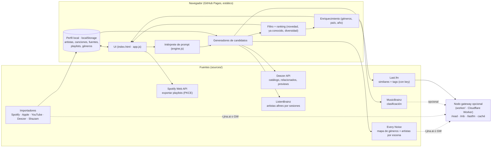

# Descubre — arquitectura

## Flujo de una búsqueda
1. **Intención** (`parseIntent`): mood/actividad, géneros (diccionario + ~6,300 géneros de Every Noise), artistas semilla (`como X`), canciones nuevas de un artista (`más de X`, `de mis artistas`), `desde mis shazams`, formato, época y región.
2. **Escenas** (`pickScenes`): géneros del prompt, géneros de tu perfil cuando no escribes nada y, si subes “qué tan nuevo”, géneros vecinos según Every Noise.
3. **Candidatos**, en paralelo:
   - Deezer: playlists por escena y artistas relacionados, a 1 y 2 pasos.
   - Every Noise: artistas de la escena, más profundos en la lista cuanto más nuevo pidas.
   - ListenBrainz y Last.fm: artistas afines a tus semillas.
   - Perfil: tus artistas o tus Shazams.
   - Deep cuts: canciones de álbumes de un artista que no tienes registradas.
4. **Filtro y ranking** (`rank`): descarta lo que ya conoces (artistas, canciones e IDs), puntúa por popularidad según la novedad pedida y penaliza las escenas repetidas.
5. **Cola** (`nextItems`): entrega 9 resultados (25 en formato playlist) y rellena para que cada ♡ / ✓ / ↻ reemplace la tarjeta en su lugar.
6. **Enriquecimiento** (`enrichTiles`): MusicBrainz agrega a cada artista géneros, país y año, con un límite de 1 petición por segundo y caché de 30 días.
7. **Salida**: playlists locales, exportar a Spotify o copiar a TuneMyMusic / Soundiiz.

## Nodo gateway (opcional)
La app funciona sin servidor. El gateway (`worker/`) se agrega cuando hace falta:
- tener **API keys fuera del navegador**, como Last.fm (y a futuro Apple Music o reconocimiento de audio);
- dejar de depender de `r.jina.ai` público, con caché en el edge (Every Noise 7 días, playlists 30 min);
- enviar a MusicBrainz un User-Agent propio, con caché.

Deploy: `cd worker && npx wrangler deploy && npx wrangler secret put LASTFM_KEY`. Después pon su URL en `config.js → apiBase`.

## Siguiente paso natural
Para sincronizar el perfil entre dispositivos hay que guardarlo en una base del gateway (D1/KV) con login. Hoy vive en `localStorage`; el respaldo JSON es la forma de moverlo entre dispositivos.
